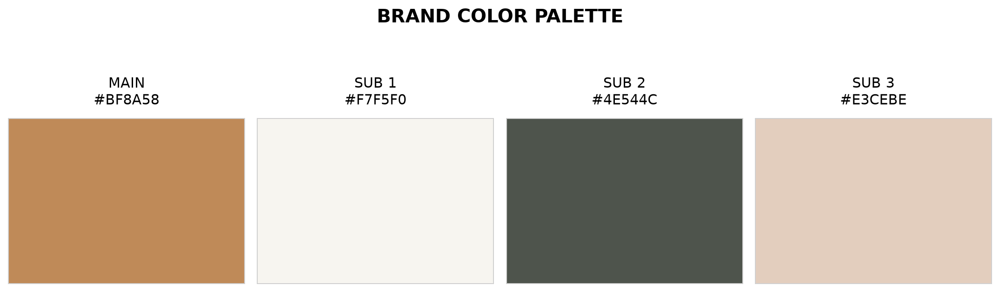
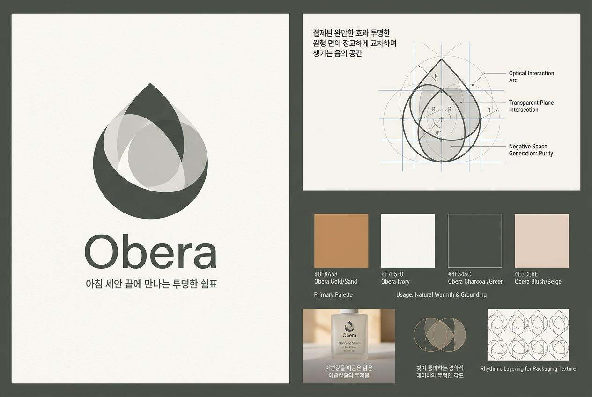
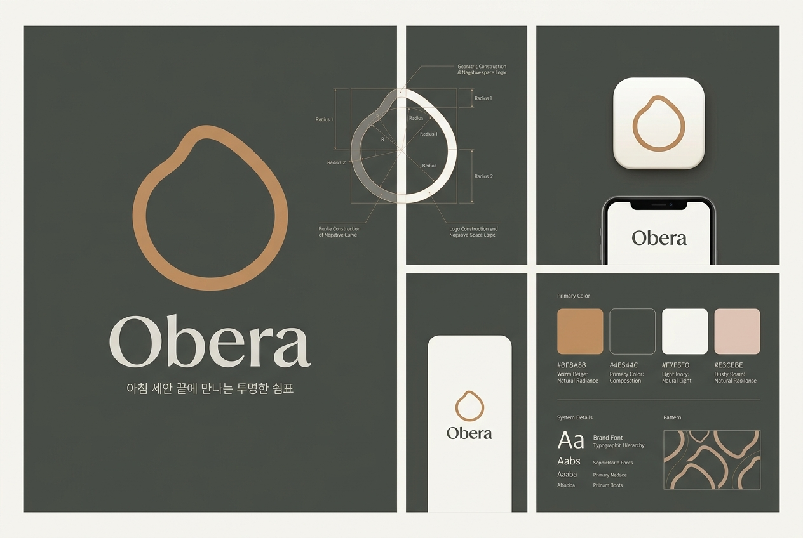
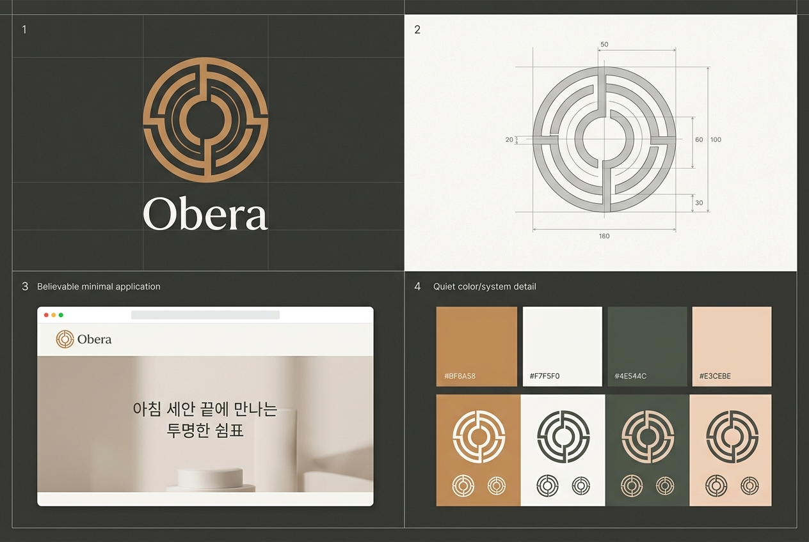

# a2-1: Gemini 브랜드 아이덴티티 생성기

JSON 브랜드 브리프를 입력받아 Google Gemini API로 네이밍, 슬로건, 브랜드 스토리,
컬러 팔레트와 로고 시안을 생성하는 Python 3.10+ CLI 프로그램이다. 텍스트는
Pydantic JSON Schema로 검증하고, 컬러 팔레트와 로고 시안은 PNG로 저장한다.

## 평가 항목 대응

| 평가 항목 | 구현 및 검증 내용 | 바로가기 |
| --- | --- | --- |
| JSON 브랜드 브리프 입력 | 업종·타깃·키워드는 필수, 톤·경쟁사·메모는 선택이며 Pydantic으로 검증 | [예제 `brief.json`](./brief.json) · [입력 코드](./brand_generator.py) |
| 네이밍 후보 3~5개와 의미 | 2~4음절, 직접적인 업종·키워드 및 반복 접미어를 피하고 한글/영문명·의미·발음 근거 생성 | [제작 원칙](#제작-원칙-반영) · [생성 코드](./brand_generator.py) |
| 슬로건/태그라인 3개 | 20자 안팎, 경험 중심, 과장·키워드·브랜드명 직접 사용을 검증 | [제작 원칙](#제작-원칙-반영) · [생성 코드](./brand_generator.py) |
| 브랜드 스토리 | 구체적 탄생 계기 → 철학 → 비전 순서, `우리` 주어와 `~다`체, 260~340자 | [생성 코드](./brand_generator.py) |
| 컬러 팔레트 | 메인 1색과 서브 2~3색, HEX 검증, 관습색·경쟁사 색상 차별화 전략 포함 | [예상 결과](#결과-파일) · [생성 코드](./brand_generator.py) |
| AI 로고 시안 2~3개 | Gemini 이미지 생성으로 기하/유기적/엠블럼 콘셉트 보드를 PNG로 저장 | [Gemini 이미지 모델](https://ai.google.dev/gemini-api/docs/image-generation) · [생성 코드](./brand_generator.py) |
| 텍스트 JSON 저장 | 단계마다 성공 결과와 오류를 `brand_result.json`에 누적 저장 | [결과 파일](#결과-파일) |
| 컬러 팔레트 PNG | matplotlib로 실제 HEX 색상을 `color_palette.png`로 렌더링 | [결과 파일](#결과-파일) |

표 구성은 [makeads의 항목 1 — 기능 동작 검증](https://github.com/codysseus42/makeads#항목-1--기능-동작-검증)을 참고했다.

## 필요한 API와 모델

별도의 텍스트 키와 이미지 키가 필요하지 않다. **Gemini Developer API 키 하나**로
두 모델을 호출한다.

| 구분 | 이 프로그램의 기본 선택 | 발급·확인 링크 |
| --- | --- | --- |
| API 키 | `GEMINI_API_KEY` | [Google AI Studio에서 키 발급](https://aistudio.google.com/apikey) · [공식 API 키 안내](https://ai.google.dev/gemini-api/docs/api-key) |
| 텍스트 생성 | `gemini-3.7-flash` | [Gemini 모델 목록](https://ai.google.dev/gemini-api/docs/models) · [구조화 출력](https://ai.google.dev/gemini-api/docs/structured-output) |
| 이미지 생성 | `gemini-3.1-flash-image` | [이미지 생성 가이드](https://ai.google.dev/gemini-api/docs/image-generation) · [가격표](https://ai.google.dev/gemini-api/docs/pricing) |
| 결제 설정 | 이미지 모델 사용 프로젝트에 필요 | [Gemini API 결제 안내](https://ai.google.dev/gemini-api/docs/billing) |

텍스트 모델은 무료 등급에서 시작할 수 있지만, 현재 기본 이미지 모델은 유료 등급이
필요하다. Google AI Studio의 API Keys 또는 Projects 화면에서 프로젝트에 결제를
연결한다. 계정에 따라 선불 또는 후불 설정이 표시되며 선불 계정은 최소 충전 조건이
있을 수 있으므로 공식 결제 화면의 안내를 따른다.

### Gemini API 키 발급 순서

1. [Google AI Studio API Keys](https://aistudio.google.com/apikey)에 로그인한다.
2. 이용약관에 동의한 뒤 기본 프로젝트를 사용하거나 새 프로젝트를 만든다.
3. **Create API key**를 눌러 프로젝트에 연결된 키를 생성하고 복사한다.
4. 이미지 생성을 사용하려면 해당 프로젝트의 **Set up billing**을 완료한다.
5. 아래 설명대로 키를 `a2-1/.env`에 넣고, 실제 `.env`는 Git에 커밋하지 않는다.

이 저장소에서는 `a2-1/.env`에 키가 없으면 기존 `b2-2/.env`의 `GEMINI_API_KEY`를
자동으로 불러와 그대로 재사용한다. 키 값은 복사하거나 출력하지 않는다.

| 우선순위 | 키를 찾는 위치 | 동작 |
| ---: | --- | --- |
| 1 | 셸 환경변수 `GEMINI_API_KEY` | 이미 설정되어 있으면 가장 먼저 사용 |
| 2 | `a2-1/.env` | a2-1 전용 설정이 있으면 사용 |
| 3 | `b2-2/.env` | 위 두 곳에 키가 없을 때 기존 키 자동 재사용 |

`b2-2/.env`는 보안을 위해 Git에 올라가지 않는다. 변수 형식은
[`b2-2/.env.example`](../b2-2/.env.example)에서 확인할 수 있다.

## 설치 및 환경 설정

```bash
cd a2-1
python -m venv .venv
source .venv/bin/activate
pip install -r requirements.txt
```

현재 저장소처럼 `b2-2/.env`에 키가 있으면 별도 복사 없이 바로 실행할 수 있다.
독립적으로 실행하거나 다른 키를 사용하려면 다음 명령으로 `a2-1/.env`를 만든다.

```bash
cp .env.example .env
```

그다음 `.env`를 열어 키를 입력한다.

```dotenv
GEMINI_API_KEY=발급받은_Gemini_API_키
GEMINI_TEXT_MODEL=gemini-3.7-flash
GEMINI_IMAGE_MODEL=gemini-3.1-flash-image
BRAND_LOGO_COUNT=3
```

`BRAND_LOGO_COUNT`는 과제 조건에 맞게 2 또는 3만 허용한다. 최종 로고 원칙의
기하/유기적/엠블럼 세 스타일을 모두 확인하려면 기본값 3을 사용한다. 이미지 한 장마다
비용이 발생한다.

셸 환경변수로도 설정할 수 있다.

```bash
export GEMINI_API_KEY="발급받은_API_키"
```

## 브리프 형식

필수 필드는 `industry`, `target`, `keywords`다. `tone`, `competitors`, `notes`는
생략할 수 있다.

```json
{
  "industry": "친환경 화장품",
  "target": "20~30대 여성",
  "keywords": ["자연", "순수", "건강"],
  "tone": "따뜻하고 신뢰감 있는",
  "competitors": ["이니스프리", "아로마티카"],
  "notes": "투명한 원료 철학을 강조해 주세요."
}
```

바로 실행할 수 있는 예제는 [`brief.json`](./brief.json)에 들어 있다.

## 실행

```bash
python brand_generator.py
```

프롬프트에 브리프 파일 경로와 출력 폴더를 입력한다.

```text
🎨 AI 브랜드 아이덴티티 생성기

브리프 파일 경로를 입력하세요: brief.json
출력 폴더 경로를 입력하세요 (엔터 시 ./output):
```

## 제작 원칙 반영

| 영역 | 적용된 원칙 |
| --- | --- |
| 네이밍 | 2~4음절, 부드러운 발음, 업종·키워드 직접 사용 금지, 반복 접미어 회피, 한글/영문 발음 및 주요 언어권 부정 의미 예비 점검 |
| 슬로건 | 20자 안팎, 경험과 장면 중심, 기능·성분 나열 및 검증 없는 과장 금지, 이름 후보와 키워드 직접 사용 금지 |
| 스토리 | `우리` 주어와 `~다`체, 구체적 탄생 계기 → 철학 → 비전, 슬로건 정서를 문장 복사 없이 연결 |
| 컬러 | 톤에 맞는 채도·명도, 업종 관습색을 비튼 차별화, 경쟁사 대표색 회피, 메인 중심의 절제된 팔레트 |
| 로고 | 기하/유기적/엠블럼별 서로 다른 모티프, 구체 사물의 추상화, 문자·이니셜·모노그램 없는 순수 상징 |

언어권 의미 확인과 상표 등록 가능성은 모델의 예비 검토일 뿐 법적·전문적 검증을
대체하지 않는다.

## 결과 파일

출력 폴더에 다음 파일이 저장된다.

| 파일 | 내용 |
| --- | --- |
| `brand_result.json` | 브리프, 모델명, 네이밍 3~5개, 슬로건 3개, 스토리, 컬러, 로고 전략, 자산 경로, 오류 목록 |
| `color_palette.png` | 메인 1색과 서브 2~3색을 실제 HEX 값으로 시각화한 팔레트 |
| `logo_01.png` | 기하 스타일 로고 콘셉트 보드 |
| `logo_02.png` | 유기적 스타일 로고 콘셉트 보드 |
| `logo_03.png` | 엠블럼 스타일 로고 콘셉트 보드 (`BRAND_LOGO_COUNT=3`) |

Gemini 이미지 응답은 API가 지원하는 JPEG로 받은 뒤 프로그램이 최종 PNG 파일로
변환하여 저장한다.

결과 JSON은 각 단계가 끝날 때마다 갱신된다. 중간 API 호출이 실패해도 앞 단계의
성공 결과는 남고 다음 단계는 계속 실행된다.

### 실제 실행 결과

예제 [`brief.json`](./brief.json)을 실행해 생성한 결과다. 전체 텍스트 결과와 생성
설정은 [`sample_output/brand_result.json`](./sample_output/brand_result.json)에서
확인할 수 있으며, 아래 이미지를 누르면 원본 PNG가 열린다.

#### 1. 컬러 팔레트

[](./sample_output/color_palette.png)

#### 2. 기하 스타일 로고 시안

[](./sample_output/logo_01.png)

#### 3. 유기적 스타일 로고 시안

[](./sample_output/logo_02.png)

#### 4. 엠블럼 스타일 로고 시안

[](./sample_output/logo_03.png)

## 오류 처리

- 브리프 파일 없음, JSON 문법 오류, 필수 필드 누락은 API 호출 전에 안내하고 종료한다.
- API 키가 없으면 설정 방법을 안내하고 `brand_result.json`의 `errors`에 기록한다.
- 인증·결제 권한, 호출 한도, 서버 오류, 구조화 응답 오류를 단계별로 기록한다.
- 팔레트 이미지나 특정 로고 저장이 실패해도 성공한 다른 결과는 보존한다.

## 구현 파이프라인

1. `input()`으로 브리프 파일과 출력 폴더 경로 수집
2. Pydantic으로 입력 JSON 검증
3. Gemini Interactions API와 JSON Schema로 네이밍 → 슬로건 → 스토리 → 팔레트 생성
4. 앞 단계 결과를 다음 단계에 전달해 브랜드 일관성 유지
5. matplotlib로 컬러 팔레트 PNG 렌더링
6. Gemini 이미지 모델로 기하/유기적/엠블럼 로고 콘셉트 보드 생성
7. 매 단계 `brand_result.json` 저장 및 부분 실패 보존
