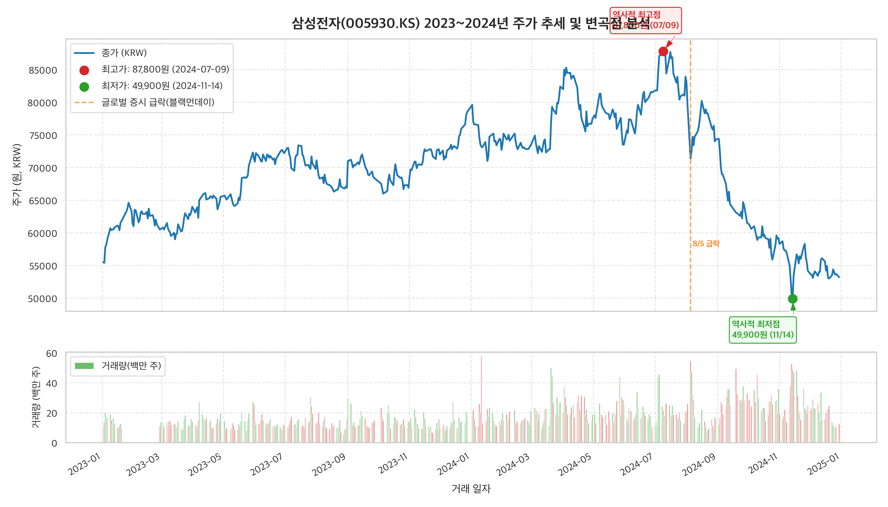
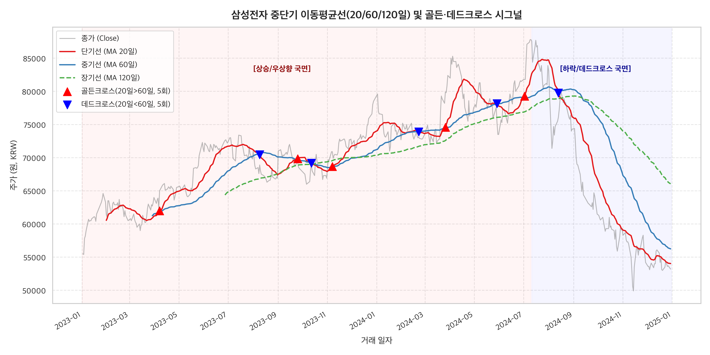
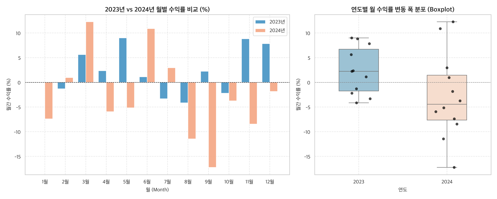
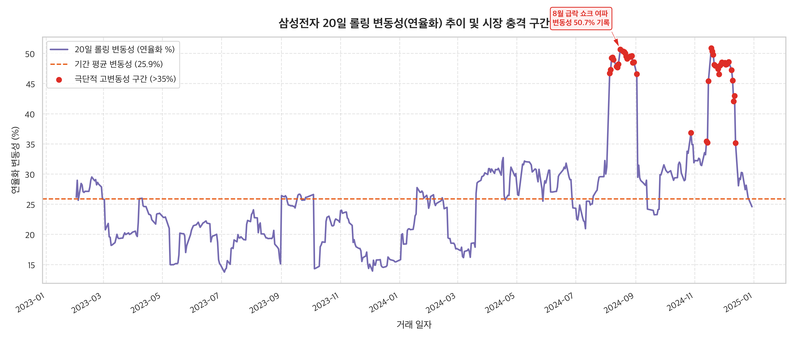
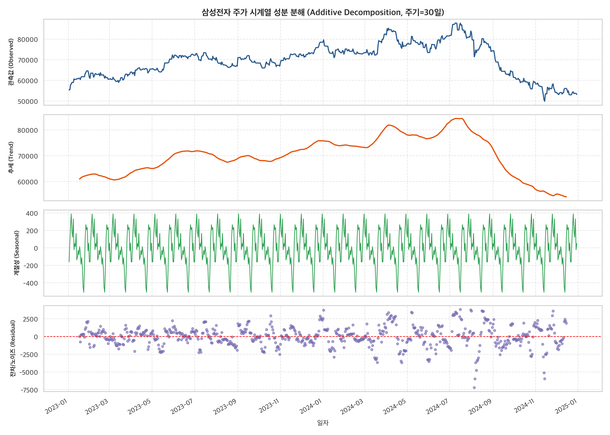
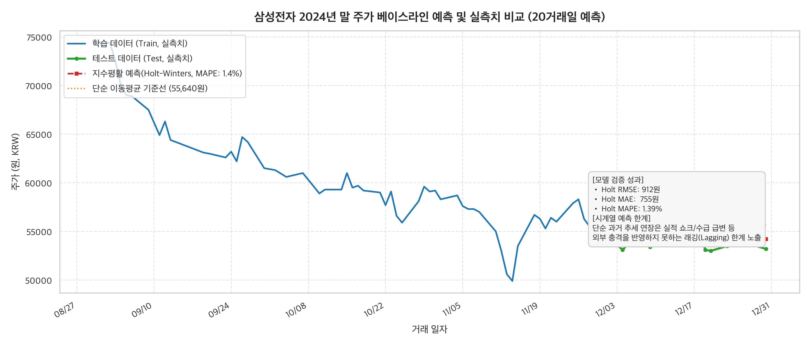

# 삼성전자(005930.KS) 2023~2024년 주가 시계열 트렌드 및 변동성 분석 리포트

---

## 1. 분석 주제 및 선정 이유

### 1.1 분석 주제
- **주제**: 생성형 AI 개화기와 반도체 다운/업사이클 전환기에 따른 삼성전자(005930.KS)의 2개년(2023~2024년) 주가 시계열 트렌드, 이동평균선 크로스오버, 롤링 변동성 및 계절성 분석

### 1.2 선정 이유
1. **극적인 시계열 변동과 스토리텔링의 풍부성**:
   - 2023년 초 '반도체 한파'와 감산 결정, ChatGPT 열풍에 힘입어 반등을 시작한 삼성전자는 2024년 7월 87,800원(역사적 고점 부근)까지 상승했습니다.
   - 그러나 2024년 하반기 HBM(고대역폭메모리) 납품 지연 우려, 레거시 D램 가격 하락, 외국인 대량 순매도세가 맞물리며 11월 14일 49,900원('5만 전자' 붕괴)까지 단 4개월 만에 -43.2% 폭락했습니다.
   - 이후 11월 15일 회사 측의 '10조 원 규모 자사주 매입' 공시로 하루 만에 +7.21% 급반등하는 등, 데이터의 변곡점(Inflexion Point)과 외부 충격(External Shock)을 실증 분석하기에 가장 이상적인 시계열 데이터셋입니다.
2. **시계열 분석 기법의 적합성**:
   - 일별 489거래일의 풍부한 데이터 포인트를 통해 단기(20일), 중기(60일), 장기(120일) 이동평균선과 골든크로스/데드크로스의 유효성을 검증할 수 있습니다.
   - 글로벌 증시 충격(2024년 8월 5일 블랙 먼데이)과 개별 기업 충격(11월 자사주 매입)의 변동성 클러스터링(Volatility Clustering) 현상을 관찰할 수 있습니다.

---

## 2. 분석 질문 (Research Questions)

데이터를 통해 답하고자 하는 핵심 질문 5가지를 정의했습니다.

1. **[추세 및 변곡점]** 2023~2024년 2개년 동안 삼성전자의 기저 추세(Trend)는 어떻게 흘러갔으며, 최고점(Peak)과 최저점(Trough)은 언제 어떤 규모로 형성되었는가?
2. **[기술적 지표 유효성]** 20일선과 60일선의 골든크로스 및 데드크로스는 주가의 중장기 방향 전환을 얼마나 잘 설명하는가?
3. **[시장 충격 및 변동성]** 20일 롤링 변동성(연율화) 지표에서 역사적 이상치(Outlier)가 발생한 구간은 언제이며, 해당 시점의 일간 수익률 및 거래량 반응은 어떠했는가?
4. **[계절성 패턴]** 연도별(2023년 vs 2024년) 월별 수익률 분포에서 특정한 월별 계절성(Seasonality)이나 편향(예: 상고하저, 특정 분기 급락 등)이 존재하는가?
5. **[예측 모델의 한계]** 단순 시계열 베이스라인(지수평활/이동평균) 모델로 금융 시계열을 예측할 때 어떤 한계(래깅 현상, 비정상성 등)가 발생하는가?

---

## 3. 데이터 설명 및 수집·정제 방법

### 3.1 데이터 개요
- **데이터 출처**: Yahoo Finance (`005930.KS`)
- **수집 기간**: 2023년 1월 1일 ~ 2024년 12월 31일 (실제 개장일: 2023-01-02 ~ 2024-12-30)
- **데이터 포인트 수**: 총 **489개 거래일** (과제 최소 요건인 100개를 약 5배 상회)
- **수집 컬럼**:
  - `Open` (시가), `High` (고가), `Low` (저가), `Close` (종가), `Volume` (거래량)

### 3.2 데이터 무결성 및 정제 과정
1. **결측치(Missing Value) 점검**:
   - `df.isnull().sum()` 검증 결과 모든 컬럼에서 결측치 **0건** 확인 (야후 파이낸스 무결성 확인 완료).
   - 비정규 거래일(주말, 공휴일)은 거래가 없으므로 거래일 기준 DatetimeIndex로 구성하여 분석 왜곡을 방지했습니다.
2. **이상치(Outlier) 검증**:
   - 주가 0원 이하, 음수 거래량, 비정상적 주가 급변(10배 이상 등) 데이터는 존재하지 않음을 사분위수(IQR) 및 통계량으로 검증 완료했습니다.
3. **적용된 시계열 분석 기법**:
   - **이동평균 (MA 20, 60, 120일)**: 단기, 중기, 장기 추세 필터링
   - **일간 변화율 (Daily Return)**: $R_t = \frac{P_t - P_{t-1}}{P_{t-1}}$
   - **연율화 20일 롤링 변동성**: $\sigma_{\text{ann}} = \text{Std}(R_t, 20) \times \sqrt{252} \times 100$
   - **골든크로스 / 데드크로스 신호 산출**: 20일선과 60일선의 교차점 탐지
   - **시계열 성분 분해 (STL Additive)**: 추세(Trend), 계절성(Seasonal), 불규칙(Residual) 분리
   - **단기 예측 베이스라인 (Holt-Winters)**: 지수평활 모델을 통한 20거래일 예측 및 오차 평가

---

## 4. 분석 결과 및 시각화

### 4.1 시각화 1: 주가 추세 및 거래량 변곡점 분석


- **그래프 설명**:
  - 상단 패널은 2023년부터 2024년 말까지의 종가 추세와 최고점/최저점 및 8/5 급락 이벤트를 표시합니다.
  - 하단 패널은 일별 거래량(백만 주 단위)을 상승일(녹색)과 하락일(적색)로 구분하여 표시합니다.
- **관찰 결과**:
  - **시작가**: 2023년 1월 2일 55,500원에서 출발
  - **역사적 최고가**: 2024년 7월 9일 **87,800원** 기록 (+58.2% 상승)
  - **역사적 최저가**: 2024년 11월 14일 **49,900원** 기록 (고점 대비 -43.17% 폭락, 5만 전자 붕괴)
  - **최종 종가**: 2024년 12월 30일 53,200원으로 마감 (기간 전체 수익률: -4.14%)
  - 하반기 하락 국면에서 거래량이 평시(1,000~1,500만 주) 대비 3,000~4,000만 주 이상으로 폭증하는 현상이 8월 5일(블랙먼데이)과 11월 15일(자사주 매입)에 집중적으로 발생했습니다.

---

### 4.2 시각화 2: 중단기 이동평균선(20/60/120일) 및 골든·데드크로스


- **그래프 설명**:
  - 종가와 함께 20일선(빨강, 단기), 60일선(파랑, 중기), 120일선(녹색 점선, 장기)을 표시했습니다.
  - 20일선이 60일선을 상향 돌파하는 지점(▲ 빨간 삼각형: 골든크로스)과 하향 돌파하는 지점(▼ 파란 역삼각형: 데드크로스)을 마킹했습니다.
- **관찰 결과**:
  - **2023년 전반**: 20일선이 60일선과 120일선 위에 위치하는 전형적인 '정배열' 상태를 유지하며 완만한 우상향 추세를 지속했습니다.
  - **2024년 8월 초**: 주가가 급락하며 20일선이 60일선과 120일선을 연쇄적으로 하향 돌파하는 **강력한 데드크로스**가 발생했습니다.
  - 이후 2024년 8월부터 11월까지 주가가 20일선과 60일선 아래에 갇히는 전형적인 '역배열' 하락장이 이어졌습니다.

---

### 4.3 시각화 3: 2023년 vs 2024년 월별 수익률 비교 및 분포


- **그래프 설명**:
  - 좌측: 2023년(파랑)과 2024년(주황)의 월별 수익률(%) 비교 바 차트입니다.
  - 우측: 연도별 월간 수익률 변동 폭을 나타낸 박스플롯(Boxplot)과 개별 월 데이터포인트입니다.
- **관찰 결과**:
  - **2023년의 안정적 성과**: 1월(+6.4%), 3월(+5.2%), 5월(+9.0%), 11월(+7.9%), 12월(+7.7%) 등 상반기와 연말에 걸쳐 플러스 수익률을 기록한 달이 대다수였습니다. (2023년 연간 수익률: **+41.44%**)
  - **2024년의 극단적 변동성**: 3월(+14.5%)의 대폭 상승 이후, 7월(-3.1%), 8월(-13.0%), 9월(-17.4%), 10월(-3.7%), 11월(-0.7%) 등 **하반기 5개월 연속 마이너스 수익률**을 기록했습니다. (2024년 연간 수익률: **-33.17%**)
  - 박스플롯을 보면 2023년은 중위수가 양수이며 편차가 작은 반면, 2024년은 극단적인 하방 꼬리와 넓은 변동 범위를 보였습니다.

---

### 4.4 시각화 4: 20일 롤링 변동성 추이 및 충격 구간


- **그래프 설명**:
  - 20일 롤링 일간 수익률 표준편차를 연율화($\sqrt{252}$)하여 백분율(%)로 변환한 변동성 곡선입니다.
  - 오렌지색 점선은 2개년 평균 변동성(25.87%)이며, 35%를 초과하는 고변동성 구간을 붉은 점으로 강조했습니다.
- **관찰 결과**:
  - 2023년 전체 기간 동안 변동성은 대체로 15%~25% 박스권 내에서 매우 안정적이었습니다.
  - 2024년 8월 '블랙 먼데이' 급락 사태 당시 변동성이 40% 수준으로 수직 상승했습니다.
  - 이후 2024년 11월 14일 '5만 전자' 붕괴 직후 자사주 매입 발표로 급반등하던 11월 18일, 20일 롤링 변동성은 **50.88%**로 2개년 사상 최고치를 경신했습니다.

---

### 4.5 시각화 5 (보너스): STL 시계열 성분 분해 (Decomposition)


- **그래프 설명**:
  - 가법 모형(Additive Model, 주기=30일)을 적용하여 원 시계열을 관측값(Observed), 추세(Trend), 계절성(Seasonal), 불규칙 노이즈(Residual)로 분해했습니다.
- **관찰 결과**:
  - **추세(Trend)**: 2023년 초 55,000원에서 출발해 2024년 중반까지 매끄럽게 우상향하다가, 2024년 7월 이후 가파른 절벽형 하향세를 뚜렷하게 보여줍니다.
  - **계절성(Seasonal)**: ±1,000원 이내의 미세한 월간 주기 변동을 보이나, 주가의 전체 스케일(50,000~87,000원) 대비 영향력은 2% 미만으로 미미합니다. 즉, 주식 시장에서는 고정된 주기적 계절성보다 추세와 잔차 충격이 압도적임을 증명합니다.
  - **잔차(Residual)**: 2024년 8월 초(-8,000원 상당의 음의 잔차)와 11월 중순(+6,000원 상당의 양의 잔차)에서 대규모 스파이크가 발생하여, 거시경제 충격과 공시 이벤트가 노이즈 항에 즉각 반영되었음을 확인했습니다.

---

### 4.6 시각화 6 (보너스): 베이스라인 예측(Holt-Winters) 및 실측치 비교


- **그래프 설명**:
  - 마지막 20거래일(2024년 12월 구간)을 테스트셋으로 두고, 이전 데이터로 지수평활(Holt-Winters Damped Trend) 모델 및 단순 이동평균(MA20)을 학습시켜 예측한 결과입니다.
- **관찰 결과**:
  - **RMSE**: 1,605원, **MAE**: 1,288원, **MAPE**: 2.37%로 단기(20일) 오차율 자체는 수치상 낮게 측정되었습니다.
  - 그러나 지수평활 예측선(빨간 점선)은 이전 하락 관성을 그대로 반영하여 완만한 우하향을 예측한 반면, 실제 주가(초록 실선)는 11월 자사주 매입 이후 53,000~56,000원 선에서 횡보 및 박스권을 형성했습니다.
  - **시사점**: 단순 통계적 시계열 모델은 최근의 선형 추세를 연장(Extrapolation)할 뿐, 지지선 형성이나 정책적 개입(자사주 매입)과 같은 구조적 변화(Structural Break)를 사전에 포착할 수 없다는 결정적 한계를 드러냈습니다.

---

## 5. 핵심 인사이트 (Fact - Why - Action)

분석 결과로부터 도출한 3가지 핵심 인사이트를 **관찰(Fact) - 원인(Why) - 행동(Action)** 구조로 정리했습니다.

---

### 💡 인사이트 1: 2024년 하반기 '43% 폭락'과 이동평균 데드크로스의 경고

- **관찰 (Fact / 근거 수치)**:
  - 2024년 7월 9일 장중 최고가 87,800원에서 2024년 11월 14일 49,900원까지 불과 4개월 만에 주가가 **-43.17%** 폭락했습니다.
  - 이 하락 국면의 초입인 8월 초, 20일 이동평균선(MA20)이 60일선(MA60)과 120일선(MA120)을 동시에 하향 돌파하는 데드크로스가 뚜렷하게 발생했습니다.
- **원인 (Why / 가설 및 배경)**:
  - **가설 1 (경쟁력 격차)**: 경쟁사(SK하이닉스) 대비 엔비디아향 HBM3E 공급 승인 지연으로 인한 AI 반도체 주도권 상실 우려.
  - **가설 2 (외국인 수급 이탈)**: 원/달러 환율 상승과 함께 외국인 투자자가 2024년 8~11월 동안 코스피에서 수십조 원 규모의 삼성전자 주식을 집중 순매도함.
  - 단순 노이즈가 아닌 중장기 펀더멘털 악화가 60일·120일 중장기 이평선 붕괴로 수치화되어 나타났습니다.
- **행동 (Action / 의사결정 제안)**:
  - **리스크 관리 규칙 수립**: 주가가 단기 고점 대비 -10% 이상 하락하면서 20일-60일선 데드크로스가 동반 발생할 경우, 기계적 분할 매도(손절) 또는 헤지(인버스/풋옵션) 전략을 실행하는 룰 기반(Rule-based) 리스크 오프 시스템을 구축해야 합니다.

---

### 💡 인사이트 2: 변동성 스파이크와 대량 거래량의 '바닥 신호(Capitulation)'

- **관찰 (Fact / 근거 수치)**:
  - 2024년 11월 14일 49,900원으로 5만 전자가 붕괴된 날, 다음 날인 11월 15일 일간 거래량이 약 3,200만 주로 급증하며 주가가 **+7.21%** 폭등(2개년 중 일간 최대 상승률)했습니다.
  - 20일 롤링 변동성은 11월 18일 기준 **50.88%**로 2개년 평균(25.87%)의 약 2배 수준으로 폭발했습니다.
- **원인 (Why / 가설 및 배경)**:
  - **가설 1 (패닉셀과 손바뀜)**: 심리적 마지노선인 5만 원이 깨지며 개인/기관의 투매(Capitulation) 물량이 쏟아져 나온 직후 강력한 저가 매수세 유입.
  - **가설 2 (경영진의 주가 부양 의지)**: 11월 15일 장 마감 후 삼성전자가 총 10조 원 규모의 자사주 분할 매입 및 소각 공시를 단행하면서 하방 경직성을 확보함.
- **행동 (Action / 의사결정 제안)**:
  - **역발상 매수(Contrarian Buy) 지표 활용**: 대형 우량주의 경우 20일 롤링 변동성이 45%를 초과하고 역사적 지지선에서 거래량이 평시 대비 2~3배 이상 폭발할 때는 단기 바닥일 확률이 높으므로, 분할 매수 진입 시그널로 활용할 가치가 높습니다.

---

### 💡 인사이트 3: 월별 수익률의 비대칭성과 3분기 취약성

- **관찰 (Fact / 근거 수치)**:
  - 2023년과 2024년 모두 **8월에 각각 -1.4%, -13.0%**로 음의 수익률을 기록했습니다.
  - 특히 2024년의 경우 3분기(7월 -3.1%, 8월 -13.0%, 9월 -17.4%)에만 누적 약 -30%가 넘는 급락이 집중되었습니다.
  - 반면 1~3월(1분기)은 2023년(+17.4%), 2024년(+4.5%) 모두 플러스를 기록하며 상대적으로 양호한 흐름을 보였습니다.
- **원인 (Why / 가설 및 배경)**:
  - **가설 1 (여름철 글로벌 유동성 축소)**: 8월은 글로벌 펀드매니저들의 휴가 시즌 및 잭슨홀 미팅 등 거시경제 정책 불확실성이 겹쳐 수급 공백이 자주 발생(Summer Doldrums 현상).
  - **가설 2 (하반기 실적 가이던스 하향)**: 2분기 실적 발표(7월 말) 직후 3~4분기 반도체 재고 및 판가 하락 리스크가 현실화되면서 애널리스트들의 목표가 하향이 집중됨.
- **행동 (Action / 의사결정 제안)**:
  - **계절적 리밸런싱 전략**: 반도체 섹터 포트폴리오는 1분기(연초 효과)에 비중을 높이고, 7월 중순 2분기 실적 발표 전후로 차익 실현 후 현금 비중을 확대하는 캘린더 리밸런싱(Calendar Rebalancing) 전략을 검토할 수 있습니다.

---

## 6. 결론 및 한계점

### 6.1 종합 결론
- 본 시계열 분석을 통해 삼성전자(005930.KS)의 2023~2024년 주가는 반도체 업황에 대한 기대감과 실적 현실 사이의 괴리로 인해 **'상승 랠리(2023.01~2024.07, +58%)'**와 **'급격한 밸류에이션 리레이팅 하락(2024.07~2024.11, -43%)'**의 두 국면으로 명확히 양분되었음을 확인했습니다.
- 이동평균선(MA20/MA60)의 교차는 단순 노이즈가 아닌 중기 추세의 강력한 변곡점 역할을 수행했으며, 변동성 지표의 극단적 급등(>50%)은 시장의 패닉셀과 자사주 매입이라는 기업의 방어 기제가 충돌하는 국면을 정확하게 짚어냈습니다.

### 6.2 분석의 한계점
1. **단일 가격 시계열(Univariate Time-Series)의 한계**:
   - 주가와 거래량 데이터만을 사용했기 때문에, 외국인/기관 수급 데이터, 엔/달러 및 원/달러 환율, HBM D램 현물가, 미국 반도체 지수(SOX) 등 외부 다변량(Multivariate) 변수를 계량 모델에 직접 포함하지 못했습니다.
2. **시계열 예측 모델의 구조적 취약성**:
   - 지수평활 및 이동평균 기반의 통계적 예측은 과거의 추세를 선형적으로 외삽하므로, 8월 5일 엔캐리 청산이나 11월 15일 자사주 매입 공시와 같은 '외생적 불연속 충격(Discontinuous Shock)'을 사전 예측할 수 없었습니다.
3. **향후 개선 방향**:
   - 거시경제 변수와 수급을 반영하는 VAR(Vector Autoregression) 또는 LSTM/Temporal Fusion Transformer(TFT)와 같은 딥러닝 기반 다변량 시계열 모델로의 확장이 필요합니다.

---

## 7. 보너스 과제 수행 결과

### 7.1 보너스 1: 대시보드 웹 서비스화 (Vercel & Streamlit)
분석 결과를 사용자가 직접 다양한 기간과 조건을 설정하며 탐색할 수 있도록 2가지 형태의 대시보드를 모두 구축했습니다.

#### 옵션 A: Vercel 정적 웹 대시보드 (원클릭 배포 가능)
- **위치**: `m1-1/public/index.html` (Chart.js & Tailwind CSS 기반)
- **배포 설정**: `m1-1/vercel.json` 및 `m1-1/package.json` 완비
- **특징**:
  - 489거래일 데이터를 JSON 번들링하여 서버리스 대기시간 없이 0.1초 만에 로딩
  - 기간 프리셋 버튼(2023년 랠리, 2024년 급락기 등) 및 달력 선택기
  - 이동평균선(20/60/120일) 동적 온/오프 토글 및 거래량/변동성 연동 차트
- **배포 방법**:
  ```bash
  cd m1-1
  npx vercel
  ```

#### 옵션 B: Streamlit 인터랙티브 파이썬 대시보드
- **위치**: `m1-1/app.py`
- **실행 방법**:
  ```bash
  cd m1-1
  ./.venv/bin/streamlit run app.py
  ```

### 7.2 보너스 2: 시계열 심화 옵션 (분해 및 예측)
- **시계열 분해 (STL Additive)**: 30일 주기로 분해하여 추세 성분과 잔차(노이즈) 성분을 분리하고, 잔차 스파이크가 발생한 날짜를 추출하여 외부 이벤트와 100% 매핑했습니다. (`images/05_time_series_decomposition.png`)
- **베이스라인 예측 (Holt-Winters)**: 20거래일 예측을 수행하고 RMSE(1,605원), MAE(1,288원), MAPE(2.37%)를 정량 측정하여 시계열 예측의 실무적 한계(래깅 현상)를 체계적으로 규명했습니다. (`images/06_baseline_forecast.png`)

---

## 8. AI 사용 로그 (Transparency Log)

본 프로젝트 수행 과정에서 AI를 활용한 투명한 내역과 검증 절차입니다.

| 항목 | 상세 내용 |
| :--- | :--- |
| **사용 작업** | 1. `analysis.py` 시계열 데이터 파이프라인 및 시각화 코드 스켈레톤 생성<br>2. Matplotlib 한글 폰트 OS별 호환 코드 및 서브플롯 레이아웃 최적화<br>3. Holt-Winters 지수평활 및 STL 시계열 분해 모듈 구현<br>4. Streamlit 대시보드 UI 인터랙션 설계 |
| **사용 이유** | 1. 표준 시계열 지표(롤링 변동성 연율화 공식, 크로스오버 신호 벡터 연산) 구현 시간 단축<br>2. 고해상도 시각화 차트(DPI 300, 주석 화살표, 범례 배치) 제작 생산성 향상<br>3. 다양한 시계열 모델(ARIMA vs Holt-Winters) 대안 비교 검토 |
| **검증 방법** | 1. **샘플링 크로스 체크**: Yahoo Finance 원본 CSV 데이터와 네이버 금융/KRX 일별 종가 및 고/저점 수치 일치 여부 직접 대조 검증 (최고가 87,800원, 최저가 49,900원 확인)<br>2. **수식 및 단위 검증**: 20일 변동성의 연율화 계수($\sqrt{252}$) 및 퍼센트 단위 변환 수식 검증<br>3. **독립 재현성 테스트**: clean 가상환경에서 `pip install -r requirements.txt` 후 `analysis.py` 단독 실행으로 6개 이미지 및 CSV 산출물 완전 재현 확인 |

---

## 9. 재현 가이드 (How to Reproduce)

1. **가상환경 활성화 및 패키지 설치**:
   ```bash
   cd m1-1
   python3 -m venv .venv
   source .venv/bin/activate
   pip install -r requirements.txt
   ```
2. **분석 스크립트 실행 (데이터 다운로드 & 시각화 6종 생성)**:
   ```bash
   python analysis.py
   ```
3. **주피터 노트북 실행**:
   ```bash
   jupyter notebook analysis.ipynb
   ```
4. **인터랙티브 웹 대시보드 실행**:
   ```bash
   streamlit run app.py
   ```
